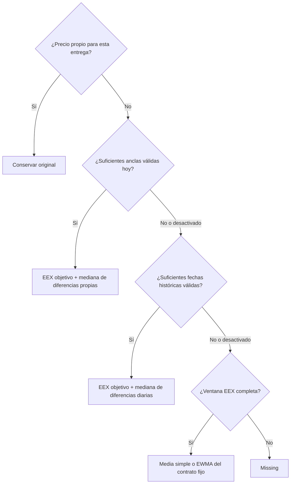

# Algoritmo VWAPSb: decisiones, ejemplos y parámetros

[English](ALGORITHM.md) · [Instalación](README.es.md) · [Backtest](BACKTEST.es.md) · [Diccionario del output](OUTPUT.es.md)

## 1. Para qué sirve, explicado a nivel de producto

Queremos un precio para cada periodo de entrega de cada producto y fecha de referencia. Tenemos algunos precios propios observados y muchos huecos. EEX aporta una referencia, pero nuestra curva no tiene por qué ser igual a EEX.

Si ya existe un precio propio, lo conservamos. Si falta, primero preguntamos: «¿Los contratos propios próximos de hoy, de la misma familia, nos dicen cuánto estamos por encima o por debajo de EEX?». Si no, hacemos esa pregunta con observaciones anteriores. Si tampoco hay suficiente información propia, promediamos cotizaciones EEX anteriores del mismo contrato de entrega. Si falta información incluso para esa media, dejamos `missing`.

Son pasos en orden: **no hay mezcla LOCAL+HIST, ni porcentajes 60/40, ni un filtro automático de calidad**. Cuando un paso funciona, termina la búsqueda. Comparar si un procedimiento es mejor que otro es tarea del backtest, antes de elegir una configuración de producción.

## 2. Datos y fechas: conceptos que no hay que confundir

Una curva se identifica por `(product, region, unit)`. El mapping editable la vincula a un CSV EEX y unas convenciones de horas de entrega. Solo se procesa con `use=fill` y archivo EEX asignado. No se buscan anclas en otros productos.

La **fecha de referencia** es el día cuya curva queremos construir. El **periodo de entrega** es lo que estamos valorando: `[delivery_start, delivery_end)`, con final exclusivo. M+1 el 30 de septiembre significa octubre; M+1 el 1 de octubre significa noviembre. El enlace con EEX usa ese periodo físico, no el texto M+1.

La **fecha de publicación** determina qué información EEX podemos usar. Para una curva del viernes, offset `0` permite viernes; `-1`, como máximo jueves; `-2`, como máximo miércoles. Un lunes con `-1` tiene corte en domingo: la publicación efectiva puede ser del viernes. Son días naturales. Si todavía no existe el settlement de hoy, `0` también puede usar ayer. Nunca se consulta una publicación posterior al corte. Este control funciona por fecha, no por hora intradía ni por revisiones posteriores de un mismo CSV.

Además se comprueba `max_stale_days`. Para LOCAL/HISTORY, un contrato ausente no se recupera silenciosamente de otra foto anterior. Sí se puede construir una referencia EEX a partir de contratos de la misma foto, si contienen información completa; se explica en el apartado 7.

## 3. Caso ORIGINAL: conservar lo observado

Si hay observación propia para el periodo físico objetivo, se conserva. Un noviembre propio a 105 sigue en 105 aunque EEX esté en 100. No se corrige con el histórico.

La tabla canónica tiene un valor por fecha/curva/tenor. Si hay varias observaciones del mismo contrato físico, se consolidan: los volúmenes positivos ponderan sus precios. Si hay alguno positivo, las observaciones con volumen cero/desconocido no entran en esa media ponderada. Si ninguno es positivo, se hace media simple. Para comprobar el volumen mínimo de un ancla, se suman los volúmenes no negativos conocidos. Las filas y precios individuales originales siguen intactos en `enriched.csv`.

Un alias del mismo contrato observado puede reutilizarlo (`own_reused`). Esto **no significa copiar el precio de ayer**. Los tenors desconocidos se conservan en el input enriquecido, pero no tienen un periodo canónico calculable. Un contrato con cero horas de entrega bajo su perfil no se estima.

Los alias objetivo estimados con el mismo periodo físico y las mismas horas de entrega también comparten un cálculo. Por ejemplo, cuando BOW es exactamente mañana, D+1 y BOW no pueden tener precios contradictorios por llamarse distinto. Se prefiere como representante una familia estándar frente a un resto de periodo, independientemente del orden de la lista de objetivos. `details.equivalent_target` registra ese representante. Es la misma entrega bajo dos nombres: no habilita que un día normal estime un mes completo.

## 4. Caso LOCAL: diferencias que observamos hoy

Un **ancla** es un precio propio observado que sirve para estimar otro. Debe tener precio legible, volumen suficiente según el umbral, referencia EEX para su mismo periodo, la misma familia del objetivo y distancia dentro de `local_max_steps`.

Las familias se mantienen separadas: Day, Weekend, BOW, Week, BOM, Month, Quarter, Season, Year. **D+1 no puede estimar un mes; M+1 no puede estimar un trimestre o un año.** Con radio 2, un mes a dos meses de distancia puede entrar; a tres meses, no. Para trimestres se cuentan trimestres; años, años; temporadas, semestres; Week/Weekend/BOW, semanas que comienzan el lunes; Day, días; Month/BOM, meses. Se usan bloques de calendario, no distancias porcentuales.

Para cada ancla elegible calculamos `precio propio − referencia EEX`. Tomamos la **mediana** de esas diferencias y la sumamos al EEX del objetivo. Cada ancla física cuenta una vez. El volumen filtra anclas y consolida duplicados; no da más peso en la mediana a la de mayor volumen. La cercanía determina si entra: una ancla a un paso no pesa más que otra a dos pasos.

Ejemplo: M+1 tiene propio=105 y EEX=100, diferencia +5. M+4 tiene propio=118 y EEX=110, diferencia +8. Para rellenar M+2 con radio 2 entran ambas: distancias 1 y 2. La mediana de dos valores es su punto medio: +6,5. Con EEX objetivo=103, sale 109,5. Un Q+2 observado queda fuera por ser otra familia. Con radio 1 solo entra M+1 y sale 108.

LOCAL se utiliza en cuanto cumple `local_min_anchors`. Si no, se intenta HISTORY. No se comprueba en ese momento si LOCAL sería mejor que HISTORY: el precio real del hueco es desconocido. La mediana aporta cierta resistencia a extremos, pero una única ancla puede estar equivocada y dos anclas no permiten descartar robustamente una de ellas.

## 5. Caso HISTORY: diferencias propias frente a EEX en días anteriores

Solo se intenta si LOCAL no funcionó o está desactivado. Pregunta: «¿En días anteriores, cuánto por encima o por debajo de EEX estaban nuestras observaciones de vencimientos comparables?».

Con `history_window_days=30`, para el 10 de octubre se miran fechas propias desde el 10 de septiembre hasta el 9 de octubre, incluidos ambos extremos. También deben estar en o antes del corte EEX actual. Solo valen **precios propios originales emparejados con EEX publicado exactamente en su misma fecha histórica**. Una fecha sin EEX de ese día, con volumen insuficiente o familia/plazo incompatible no aporta esa observación. Las estimaciones anteriores nunca se convierten en evidencia histórica.

Se compara la misma familia y el plazo relativo de entrega, con el mismo radio `local_max_steps`. Un M+1 histórico conserva plazo 1 aunque antes entregara octubre y el M+1 actual entregue noviembre. Para un M+3 actual y radio 2, pueden entrar M+1 a M+5 históricos. Se agrupan deliberadamente vencimientos próximos; no se aprende un modelo separado para cada mes físico ni su estacionalidad. El cambio de mes/trimestre/año queda resuelto al enlazar periodos EEX, pero puede cambiar el comportamiento económico que estamos suponiendo comparable.

Primero se calcula una mediana de diferencias propias−EEX **dentro de cada día histórico**. Después, la mediana de esas medianas diarias. Cada día tiene un voto: uno con veinte observaciones no pesa más que otro con una. Se exigen `history_min_days` fechas distintas válidas, no ese número de filas.

Ejemplo: tres días tienen diferencias diarias +4, +7 y +5. La mediana es +5. Si EEX actual del objetivo vale 100, se estima 105. Con solo dos fechas válidas y mínimo 3, HISTORY no se utiliza y se pasa al promedio EEX. Aumentar la ventana de 30 días admite evidencia más antigua; aumentar el mínimo exige más evidencia. Aquí no hay EWMA histórico, tamaño efectivo de muestra, shrink, comparación automática de aceptación ni mezcla con LOCAL.

## 6. Caso EEX promediado: último recurso estimado

Solo se alcanza si las dos etapas propias no han funcionado. Se resuelve una vez el **periodo físico fijo del objetivo**. Se toman las últimas `eex_window` fechas de publicación hasta la foto permitida. Se busca ese mismo contrato en cada fecha. Todas deben tener una referencia utilizable: no se saltan fechas sin precio, no se rellenan hacia delante y no se acepta una sola cotización.

Ejemplo: al rellenar noviembre el 1 de octubre, se pueden usar cotizaciones de noviembre publicadas en septiembre. No se promedia el texto «M+1» atravesando el cambio de mes, porque en septiembre M+1 era octubre.

Con precios 90, 92, 94, 96, 98 de más antiguo a reciente:

- `simple`: cada precio pesa 20%; resultado=94.
- `ewma`, semivida 2: pesos sin normalizar aproximadamente 0,25; 0,354; 0,5; 0,707; 1. Se dividen por su suma; resultado≈95,32. El último pesa el doble que el de dos publicaciones antes.

La fórmula es `peso(edad) = 2 ** (-edad / eex_halflife)`, con edad=0 para el más reciente. Se cuentan **publicaciones, no días naturales**. La media queda limitada a la ventana configurada. Menor semivida reacciona más deprisa; mayor se acerca a una media simple de la ventana. Se exigen al menos dos publicaciones. Un ajuste extremo cuyos pesos numéricos colapsen a una sola observación no debe convertirse en EEX puro.

Esta transformación no aprende nuestra prima propia y puede ir retrasada tras un movimiento brusco. Un contrato corto puede no tener cinco publicaciones previas y quedar `missing`. No hay propagación de spreads de arriba abajo ni otra ventana de nueve días. Una media calculada o una corrección aditiva cero pueden coincidir numéricamente con el último EEX: se prohíbe el método de copia directa, no una coincidencia legítima de números.

Con precios cero, cercanos a cero o negativos, las operaciones aditivas siguen definidas: propio=-2 y EEX=-5 producen diferencia=+3. No se divide por ningún precio. Se evita así la inestabilidad del ratio, sin demostrar por ello que una diferencia fija en euros sea adecuada en todos los mercados.

## 7. Referencias construidas y coherencia de la curva

Construir una referencia EEX es distinto de estimar con precios propios. Se prefiere un contrato EEX exacto. Si no existe, se puede combinar una tira completa de contratos contiguos ponderada por horas. También se puede calcular un tramo final restando al valor total una parte inicial completamente conocida. No se deduce un precio a partir de información parcial arbitraria.

Un trimestre construido con tres meses es `(mes1×horas1 + mes2×horas2 + mes3×horas3) / horas_totales`. Los meses no tienen que tener el mismo precio. Base respeta zona horaria y cambios de hora; Peak usa las convenciones del perfil, incluida la convención especial de fin de semana del módulo de calendario. Es necesario verificar `hours` y `timezone` contra el contrato real.

La auditoría final busca una cobertura completa y sin solapamiento de un contrato mediante otros menores. No suma meses y trimestres que se pisan. Informa `precio_padre − precio_hijos`: positivo significa que el contrato mayor vale más que sus hijos ponderados. Que no haya comprobación puede significar que faltan hijos, no que la curva sea perfecta.

**No se aplica ajuste de forma.** Mantener originales y estimar familias por separado puede dejar un trimestre observado a 120 mientras sus meses estimados promedian 128. La auditoría señala diferencia -8, pero no modifica ninguno. También pueden aparecer saltos cuando dos objetivos próximos utilizan anclas distintas. La mediana conserva la forma EEX únicamente donde se aplica la misma corrección: no garantiza suavidad ni coherencia de toda la curva. Es una limitación explícita de esta versión más sencilla que hay que revisar en gráficos y backtest.

## 8. Los diez parámetros del modelo

Están en `[model]`. En modo individual, cada fila del mapping puede sobrescribir cualquiera de ellos; una celda vacía hereda el TOML. Son valores iniciales, no una calibración obtenida con tus datos.

| Parámetro | Defecto | Qué significa y qué cambia |
|---|---:|---|
| `local_enabled` | true | Permite usar observaciones de hoy. False pasa directamente al histórico. |
| `history_enabled` | true | Permite diferencias históricas cuando falla LOCAL. False pasa a EEX promediado. |
| `local_max_steps` | 2 | Radio entero no negativo para distancia de entregas LOCAL y distancia de plazos relativos HISTORY. Subirlo mezcla más vencimientos; bajarlo selecciona más. |
| `local_min_anchors` | 1 | Mínimo de contratos físicos elegibles hoy. Subirlo reduce dependencia de una única ancla, pero también la cobertura LOCAL. |
| `min_volume` | 0 | Volumen propio válido acumulado mínimo, en unidades del volumen del input. Afecta LOCAL/HISTORY, no conservar originales. Con 0 se admite volumen desconocido; con un umbral positivo se excluye. |
| `history_window_days` | 30 | Ventana positiva de días naturales anteriores, sin incluir hoy. Más ventana incorpora regímenes antiguos. |
| `history_min_days` | 3 | Fechas históricas válidas distintas necesarias; mínimo 1 y máximo la ventana. No es un umbral de error. |
| `eex_window` | 5 | Número de publicaciones más recientes exigidas para el mismo contrato físico; mínimo 2. Más suavizado puede implicar menos cobertura. |
| `eex_average` | ewma | `simple` o `ewma`, solo para la última etapa EEX. |
| `eex_halflife` | 2 | Semivida positiva y finita en número de publicaciones. Solo afecta EWMA. |

Desactivar LOCAL e HISTORY permite evaluar un modelo base EEX promediado. Desactivar solo LOCAL permite evaluar histórico antes de recurrir a EEX. No quedan estrategias adicionales ocultas.

## 9. El resto de la configuración

| Sección | Claves | Finalidad |
|---|---|---|
| `[paths]` | `vwap_input`, `mapping`, `eex_curves_dir`, `output_dir` | Input original/patrón, tabla editable, raíz EEX, resultados. Relativas al TOML. |
| `[run]` | `configuration_mode` | `global` o `individual`: origen de los diez valores del modelo. |
| `[targets]` | `tenors` | Lista editable de objetivos. También se conservan observaciones reconocidas del día. BOW/BOM vacíos no generan filas. |
| `[eex]` | `offset_days`, `max_stale_days` | Corte de publicación <=0; antigüedad máxima natural, 0 ilimitada. |
| `[conventions]` | `day`, `weekend_offset` | D+n usa `calendar` o `business` (lunes–viernes, sin festivos). WE es el siguiente sábado estrictamente posterior a la fecha; el offset entero desplaza semanas. |
| `[vwap_columns]` | `reference_date`, `product`, `region`, `unit`, `tenor`, `vwap`, `volume` | Relaciona cada significado con su encabezado real en el input. |
| `[timezones]` | `default` y nombres de áreas | Zonas por defecto al crear mapping o si una fila no la informa. Gana la zona explícita de la fila. |

Columnas del mapping: `product, region, unit, use, area, profile, eex_file, hours, timezone, comment`, más columnas opcionales de parámetros del modelo. `area` y `profile` son descriptivos; `hours` controla realmente Base/Peak/Peak7. `eex_file` es relativo a la raíz EEX o una ruta absoluta explícita. `comment` admite texto libre. No se admiten sobrescrituras de rutas, calendarios o tenors como columnas de parámetros.

Argumentos: `--config` elige TOML; `--vwap` sobrescribe input; `--date` elige fecha daily/check; `--start/--end` eligen intervalo incluido; `--eex-offset` modifica disponibilidad para esa ejecución. Backtest añade `--grid` JSON, `--mask-fraction` y `--seed`. Sus equivalentes en notebook y el criterio de evaluación están en la guía de backtest.

## 10. Trazabilidad y límites

`status` indica original/estimated/missing; `method` identifica el único método elegido. `details` guarda configuración efectiva, anclas locales aceptadas/rechazadas, días históricos y pesos EEX según corresponda. Tras un paso satisfactorio no se evalúan los siguientes: HISTORY con contador cero en una fila LOCAL no significa que la base de datos carezca de histórico. Se guarda la huella de configuración y la fecha EEX real.

Es un procedimiento determinista para electricidad, no un modelo universal para agricultura u otros activos. Supone moneda, unidad y definición de entrega compatibles entre propio y EEX. Antes de depender operativamente de los resultados hay que validar mapping, revisiones de origen, calendarios, cobertura, errores y cambios de mes/trimestre con los datos de empresa. Los tests sintéticos verifican comportamiento; no certifican precisión de mercado.
