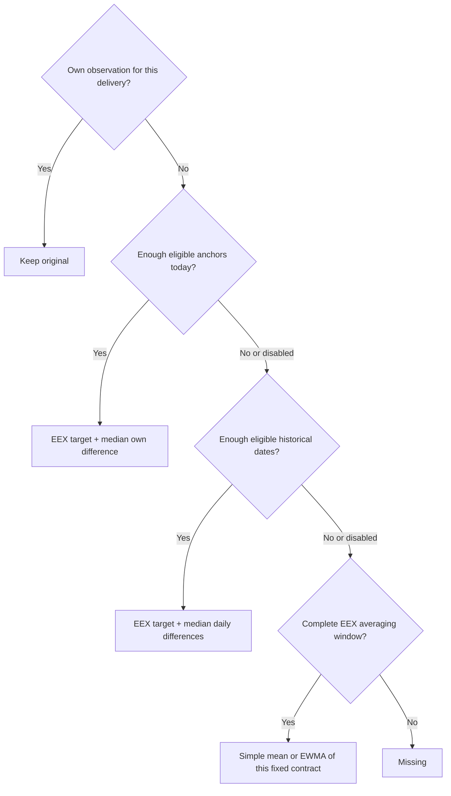

# VWAPSb algorithm: decisions, examples and settings

[Español](ALGORITHM.es.md) · [Setup](README.md) · [Backtest](BACKTEST.md) · [Output dictionary](OUTPUT.md)

## 1. Purpose in business language

For each reference date and configured product, we want a price for each requested delivery period. Some prices are observations from our own market; others are unknown. EEX supplies a reference curve, but our curve need not equal EEX.

The procedure keeps an observed own price. For a missing price, it first asks whether today's nearby own contracts of the same family tell us how far we sit above/below EEX. If they do not, it asks that question using earlier observations. Without enough own evidence, it averages earlier EEX quotations for the same delivery contract. Without enough information even for that average, it leaves `missing`.

These are sequential choices, not seven competing models fitted each morning. **There is no LOCAL+HIST blend, no 60/40 weight and no automatic quality gate.** One successful stage ends the search. The backtest is where a person compares choices and parameters before deployment.

## 2. Inputs and the two different clocks

An own curve is identified by `(product, region, unit)`. The editable mapping connects it to a particular EEX CSV and delivery-hours convention. Only `use=fill` with an assigned EEX file is processed. No other product supplies anchors.

The **reference date** is the day whose curve we are creating. A **delivery period** is the interval being priced, `[delivery_start, delivery_end)`, with an exclusive end. M+1 on 30 September means October; M+1 on 1 October means November. EEX matches the actual interval, not the text M+1.

The **publication date** is the EEX information available for this calculation. For a Friday curve, offset `0` permits Friday, `-1` permits at most Thursday and `-2` at most Wednesday. For Monday with `-1`, the cutoff is Sunday; Friday can be the actual publication. Offsets count calendar days. If today's settlement is absent, `0` can also select yesterday. No publication after the cutoff is consulted. This controls date availability, not intraday timestamps or later revisions of an existing CSV.

The selected snapshot must also respect `max_stale_days`. An unavailable contract is not silently taken from a different older snapshot for LOCAL/HISTORY. An EEX reference can be constructed within a snapshot from a complete strip or a remaining portion; see section 7.

## 3. Preserve an observed price

If the target's physical delivery interval has an own observation, retain it. For example, a known November month at 105 remains 105 even when EEX is 100. It is not corrected by historical information.

The canonical output has one value per date/curve/tenor. Repeated observations of the same physical contract are consolidated: positive volumes weight prices; if any positive volumes exist, zero/missing-volume observations do not enter that weighted mean. If no positive volume exists, use a simple mean. Their nonnegative known volumes are summed for anchor eligibility. Input rows and individual prices remain unchanged in `enriched.csv`.

Equivalent labels for the same observed physical contract can reuse that observation (`own_reused`). This is not yesterday's price carried forward. Unknown input labels remain in the enriched input, but cannot produce resolved canonical periods. A zero-delivery-hours contract cannot be estimated under that profile.

Estimated target aliases with the same physical interval and delivery hours also share one calculation. For example, when BOW is exactly tomorrow, D+1 and BOW cannot acquire contradictory prices just because their names differ. The representative prefers standard contract kinds before remainder kinds, independently of target-list order. `details.equivalent_target` records the representative. This is equivalence of the delivery being priced, not permission for an ordinary daily contract to anchor a full month.

## 4. LOCAL: differences observed today

An **anchor** is an own observed price usable to estimate another price. It must have a readable own price, enough volume under the configured threshold, an EEX price for the same physical interval, the same contract family as the target, and a distance within `local_max_steps`.

Families are distinct: Day, Weekend, BOW, Week, BOM, Month, Quarter, Season, Year. **D+1 cannot anchor a Month; M+1 cannot anchor a Quarter or Year.** A monthly anchor two months away is eligible with radius 2; three months away is not. Quarter distance is in quarters, Year distance in years, Season in half-years, Week/Weekend/BOW in Monday-based weeks, Day in days, and Month/BOM in months. Distances use calendar buckets, not a percentage of time to delivery.

For every eligible anchor, calculate `own price − EEX reference`. Take the **median** of these differences and add it to the target EEX price. Each retained physical anchor counts once. Volume filters anchors and consolidates duplicates; it does not give a large-volume anchor more weight in the median. Proximity controls eligibility; an anchor one step away does not outweigh one two steps away.

Example: M+1 is own=105/EEX=100, so difference=+5. M+4 is own=118/EEX=110, so difference=+8. For M+2 with radius 2, both are eligible: distances 1 and 2. The median of two numbers is their midpoint, +6.5. With target EEX=103, output=109.5. A Q+2 own observation is excluded because its family differs. With radius 1, only M+1 is eligible: output=108.

LOCAL is used as soon as `local_min_anchors` is met. Otherwise the algorithm tries history. It does not test whether today's LOCAL estimate would outperform HISTORY because the target's true price is unknown. Outlier robustness comes only from the median; one eligible anchor can still be wrong, and two extreme anchors are not robustly rejected.

## 5. HISTORY: earlier own/EEX differences

HISTORY is attempted only when LOCAL did not succeed or was disabled. Its question is: “On earlier days, how much above/below EEX were our observations for comparable maturities?”

With `history_window_days=30`, a curve dated 10 October considers own dates from 10 September through 9 October inclusive. Dates must also be on/before the current EEX cutoff. Only **original own prices paired with EEX published on exactly the same historical date** qualify. Missing same-date EEX, insufficient volume or an incompatible family/lead excludes that observation. Estimated output never becomes historical evidence.

Comparable maturities use the same family and relative delivery lead, with the same `local_max_steps` radius. A historical M+1 has lead 1 even if its delivery was October and today's M+1 is November. For a current M+3 and radius 2, past M+1 through M+5 can contribute. This is deliberate pooling of nearby maturities; it does not learn a separate physical-month or seasonal model. A month/quarter/year rollover therefore does not accidentally match EEX labels, but it can still change the market behavior being assumed comparable.

First compute a median own-minus-EEX difference **within each historical day**. Then take the median of these daily medians. Each day gets one vote, so a date with twenty observations does not outweigh a date with one. Require `history_min_days` distinct eligible dates, not that many rows.

Example: three days have daily differences +4, +7, +5. Their median is +5. If current target EEX=100, output=105. With only two eligible days and minimum 3, history is rejected and the EEX averaging stage is tried. Increasing the 30-day window admits older evidence; increasing minimum days demands more evidence. This version has no historical EWMA, effective sample size, shrink factor, automatic acceptance comparison or LOCAL/HISTORY mixture.

## 6. EEX average: final estimated reference

Only reached when neither own-data stage succeeds. Resolve the target's **fixed physical delivery interval once**. Find the latest `eex_window` publication dates ending at the allowed snapshot. Obtain this same contract on each date. All required dates must have a usable reference; do not skip missing dates, fill them forward or accept just one price.

Example: filling November on 1 October may use September publications of November. It does not average “M+1” labels across the rollover, because September's M+1 is October.

With prices 90, 92, 94, 96, 98 from oldest to newest:

- `simple`: all five weigh 20%; result=94.
- `ewma`, half-life 2: unnormalized weights are approximately 0.25, 0.354, 0.5, 0.707, 1. Normalize their sum to one; result≈95.32. The newest observation has twice the weight of the observation two publication steps earlier.

The formula is `weight(age) = 2 ** (-age / eex_halflife)`, where age=0 is newest. These are **publication steps, not calendar days**. The average is truncated to the configured window. Smaller half-life reacts faster; larger half-life approaches a simple mean over that window. At least two publications are required. A numerically degenerate weight choice must not collapse this fallback to one observation.

This transformation does not learn our own price premium and can lag a sharp market movement. Short contracts may lack five earlier publications, causing `missing`. It has no top-to-bottom spread propagation and no separate nine-day spread window. A computed average or an additive correction of zero can legitimately equal the latest EEX number; the rule forbids an untransformed fallback method, not numerical equality.

If EEX has negative, zero or near-zero prices, all these additive operations remain defined: own=-2 and EEX=-5 gives difference=+3. There is no division by price. This avoids ratio instability but does not prove a fixed euro spread is suitable for every regime.

## 7. Constructing references and checking curve shape

EEX reference construction is distinct from own-price estimation. An exact EEX contract is preferred. Otherwise, the pricer can combine a complete contiguous strip by delivery hours. It can also calculate a tail from the total delivery value minus a fully known head. It cannot construct a price from arbitrary partial information.

For example, a quarter represented by three months is `(month1×hours1 + month2×hours2 + month3×hours3) / total_hours`. The months need not have equal prices. Base hours respect timezone/daylight-saving changes; Peak uses delivery conventions for that product, including the special weekend convention in the calendar helper. `hours` and `timezone` must be reviewed against the underlying contract.

The final consistency audit searches for a complete, disjoint finer cover of a longer contract. Overlapping months and quarters are not counted twice. It reports `parent_price − children_price`; a positive result means the parent is higher than the weighted children. An absent check can mean incomplete child coverage, not a perfect curve.

**There is no shape correction.** Conserving originals and estimating families independently may produce a quoted quarter at 120 while its estimated months average 128. The audit exposes the +/−8 difference but changes neither. Likewise, choosing different nearby anchors for neighboring targets can create jumps. A median correction preserves EEX shape only where the same correction is applied; it does not ensure the whole curve is smooth or coherent. This is a tradeoff of the simpler version and must be assessed in the viewer/backtest.

## 8. Every model parameter

All ten live in `[model]`. In individual mode, a mapping row can override any of them; blank cells inherit TOML. Example values are initial defaults, not empirical calibration.

| Parameter | Default | Meaning and effect |
|---|---:|---|
| `local_enabled` | true | Allow today's own observations. False goes directly to history. |
| `history_enabled` | true | Allow historical differences when LOCAL fails. False goes to EEX average. |
| `local_max_steps` | 2 | Nonnegative integer radius for LOCAL start distance and HISTORY relative-lead distance. Higher pools more maturities; lower is more selective. |
| `local_min_anchors` | 1 | Minimum distinct eligible physical contracts today. Higher reduces reliance on one anchor but reduces LOCAL coverage. |
| `min_volume` | 0 | Minimum summed valid own volume, same unit as the input volume. Applies to LOCAL and HISTORY, not retention of originals. At 0, missing volume is allowed; above 0, missing volume is excluded. |
| `history_window_days` | 30 | Positive trailing calendar-day window, excluding today. Higher includes older regimes. |
| `history_min_days` | 3 | Minimum distinct valid historical dates; at least 1 and no greater than the window. It is not an error threshold. |
| `eex_window` | 5 | Number of latest publications required for the fixed-contract fallback; minimum 2. Higher smooths more and can reduce coverage. |
| `eex_average` | ewma | `simple` or `ewma`; applies only to the final EEX averaging stage. |
| `eex_halflife` | 2 | Positive finite half-life in publication observations. Used only for EWMA. |

Disable both LOCAL and HISTORY to evaluate an EEX-average baseline. Disable only LOCAL to inspect history before EEX fallback. There are no additional hidden strategies to enable.

## 9. All remaining configuration

| Section | Keys | Purpose |
|---|---|---|
| `[paths]` | `vwap_input`, `mapping`, `eex_curves_dir`, `output_dir` | Original own input/glob, editable curve table, EEX root, output folder. Relative to TOML. |
| `[run]` | `configuration_mode` | `global` or `individual`; changes where the ten model values come from. |
| `[targets]` | `tenors` | Editable list of requested labels. Recognized observations on a date are also retained. Empty BOW/BOM intervals do not generate rows. |
| `[eex]` | `offset_days`, `max_stale_days` | Latest permitted publication offset <=0; maximum calendar age, 0 unlimited. |
| `[conventions]` | `day`, `weekend_offset` | D+n uses `calendar` or `business` days (Monday–Friday, no holiday calendar). WE is the next Saturday strictly after the reference date; integer offset shifts its week. |
| `[vwap_columns]` | `reference_date`, `product`, `region`, `unit`, `tenor`, `vwap`, `volume` | Map normalized meanings to actual input headers. |
| `[timezones]` | `default` and area names | Default delivery zones when mapping rows omit their timezone, and when drafting rows. An explicit mapping timezone wins. |

Mapping columns: `product, region, unit, use, area, profile, eex_file, hours, timezone, comment`, followed optionally by any model columns. `area`/`profile` are descriptive; `hours` actually controls Base/Peak/Peak7 delivery weighting. `eex_file` is relative to the EEX root or an explicit absolute file. `comment` is free text. No overrides of file paths, calendars or targets are accepted as model columns.

CLI options: `--config` chooses TOML; `--vwap` overrides own input; `--date` selects daily/check date; `--start/--end` select inclusive ranges; `--eex-offset` overrides availability for that execution. Backtest additionally accepts `--grid` JSON, `--mask-fraction` and `--seed`. Notebook equivalents and validation methodology are in the backtest guide.

## 10. Traceability and limits

`status` tells original/estimated/missing; `method` names the single chosen method. `details` contains effective settings, accepted/rejected local anchors, history days and averaging weights as applicable. Later stages are not evaluated after a successful earlier stage; zero history count on a LOCAL row does not mean the database has no history. Each result carries its configuration fingerprint and actual EEX date.

This is a deterministic baseline for power, not a general valuation model for agriculture or other assets. It assumes own and mapped EEX prices share currency, unit and delivery definition. Audit your mapping, source revisions, calendar conventions, coverage, errors and month/quarter roll behavior on your own data before operational reliance. Synthetic tests verify behavior; they cannot certify market accuracy.
